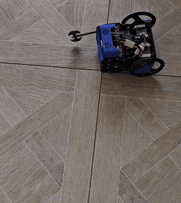
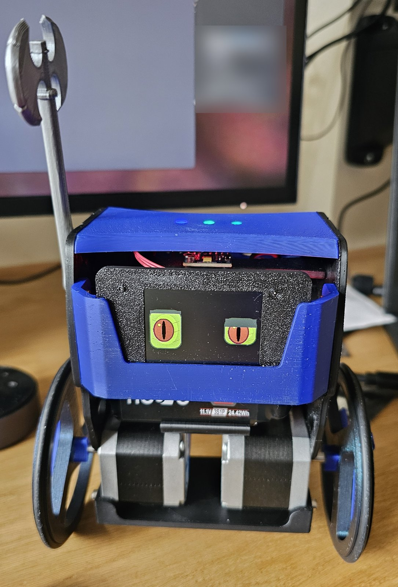
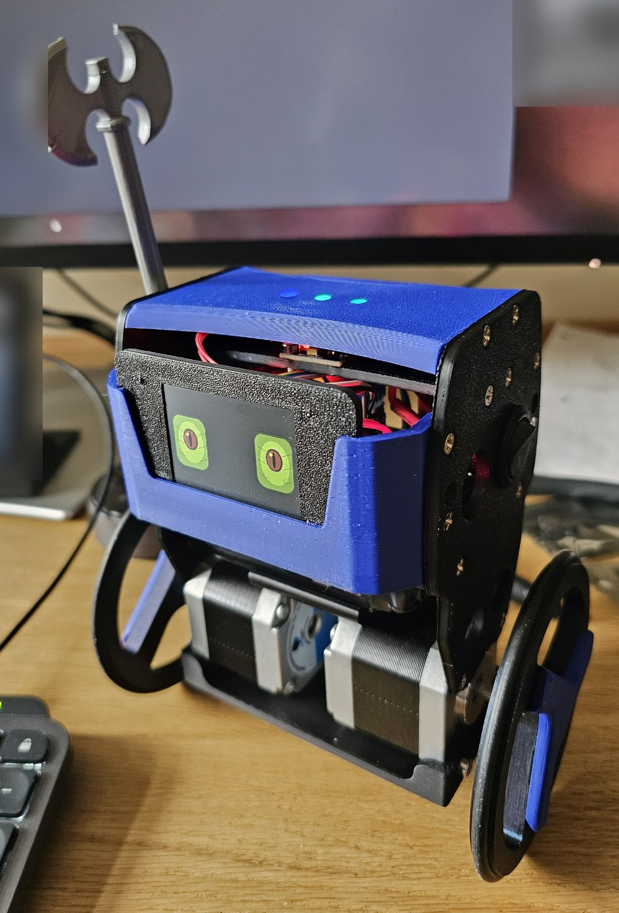
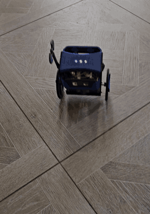

# ROLO

A two-wheeled self-balancing robot built around an ESP32, with stepper motors, a servo arm,
a Bluetooth gamepad, live telemetry over WiFi, and the ability to stand itself up after a fall.

> **Early version, work in progress.** The electronics mostly work: you can pair a gamepad
> and drive ROLO around, and it balances and stands itself up. But this is a first version,
> some improvements are already needed, and much is still being built, tuned and redesigned.
> Expect things to change, and some parts of this repository to be incomplete.
> See [Current status](#current-status).

<p align="center">
  
</p>

## Inspiration and goals

ROLO started from the [JJRobots B-Robot EVO 2](https://www.jjrobots.com/b-robot-evo-2-much-more-than-a-self-balancing-robot/)
and the [Kidbuild balance robot kit](https://www.kidbuild.de/balance-robot-kit/). I decided to
rebuild them and improve the electronics, with these goals:

- **Quieter motors:** TMC2209 stepper drivers.
- **Maximum customisation:** most of the parts redesigned in FreeCAD.
- **More sensors and accessories** than the original designs allow.
- **AI experimentation:** a face, voice, vision and a personality, in the spirit of Anki Vector.
- **A 3S battery,** and better battery management later (for example, charging without
  unplugging it).
- **Learning:** about balancing control and about AI on small robots.
- **A robotics platform for kids:** children can program ROLO themselves with
  [UIFlow](https://uiflow2.m5stack.com/) (M5Stack's block editor and MicroPython) on the
  M5Stack head, driving the robot through the same commands as the gamepad and the web pages.

<p align="center">
  
  
</p>

## Videos

<p align="center">
  
</p>

The full clip, from the stand-up to driving around:
[rolo-driving.mp4](docs/images/rolo-driving.mp4) (22 s, no sound).

## Current status

| area | status |
|---|---|
| balancing | working, tuned from recorded data |
| driving (gamepad and web joystick) | working; faster driving and steering feel still being tuned |
| standing up from lying face-down | working (arm push + wheel kick), still being refined |
| telemetry, recorder and analysis tools | working |
| web pages (drive, calibration with terminal, gamepad) | working |
| battery warnings | working |
| controller PCB (KiCad) | first version: mostly works, improvements needed (see below); files in `electronics/` |
| mechanical parts (FreeCAD) | designed, not yet published here |
| head: face, camera, microphones (M5Stack CoreS3) | hardware chosen, firmware not started |
| voice, vision, AI | planned |
| second robot and games | planned |
| battery management (charging in place) | planned |
| kids' programming (UIFlow on the M5Stack head) | planned |

### Known issues in the first electronics version

- The servo shares the 5 V supply with the logic. When it pulls hard, the supply dips enough
  to disturb WiFi and the IMU. A capacitor at the servo, or a separate supply for it, is needed.
- Few spare GPIOs are left on the controller for new sensors and accessories.
- No charging in place yet: the battery has to be unplugged to charge.

The planned fixes for the electronics and the mechanical parts are listed in
[docs/next-revision.md](docs/next-revision.md).

## Features

- **Balancing** with a cascaded controller: an angle loop (PD on a filtered gyro) inside a
  speed loop, with an acceleration feed-forward so the robot leans into speed changes.
- **Driving** from a gamepad or a web joystick, with a speed ramp shared by acceleration and
  braking.
- **Standing up** from lying face-down: the arm pushes the body up, a wheel kick drives under
  it, and the balance loop takes over mid-way, braking with a deeper lean afterwards.
- **Safety**: tilt cut-off, runaway detection, a command timeout, and battery warnings
  (LEDs and web pages).
- **Web pages** served by the robot: drive (joystick), calibration (live values, parameters,
  a terminal), and a gamepad debug page.
- **200 Hz telemetry stream** with a PC recorder and an analysis script, used to tune
  everything from measured data.
- **One command console** shared by the serial port and the web terminal.

## Repository layout

| folder | contents |
|---|---|
| `firmware/controller/` | the robot's firmware (PlatformIO, C++) |
| `firmware/tools/` | `rolo_stream.py` (recorder and test runner), `analyze.py` (report and plots) |
| `electronics/` | KiCad project for the controller board, Gerbers in `Output/` |
| `mechanical/` | mechanical design, FreeCAD (to be added) |
| `docs/` | documentation; [next-revision.md](docs/next-revision.md) lists the planned hardware changes; `images/` has the photos and videos |

## Hardware

| part | notes |
|---|---|
| ESP32 (DevKit V1, classic ESP32) | dual core: control loop on core 1, WiFi/web/LEDs on core 0 |
| 2 × TMC2209 stepper drivers | UART-configured, 1/16 microstepping, 900 mA RMS |
| 2 × NEMA17 steppers (42HD4027-01, 1.5 A) | 93.2 mm wheels |
| MPU6050 IMU | ±1000 °/s gyro, complementary filter |
| hobby servo | the arm (also used to stand up) |
| 3 × WS2812 LEDs | network, robot state, effort / battery warning |
| 3S LiPo | voltage divider (100k/22k) on GPIO 35 |
| Mini560 buck converter | 5 V for the logic and the servo |
| Bluetooth gamepad | a Switch Pro style controller, via Bluepad32 (classic Bluetooth) |

Main pin assignments are in [`firmware/controller/include/config.h`](firmware/controller/include/config.h).

## Building and flashing

Requires [PlatformIO](https://platformio.org/) (the VS Code extension or the CLI).

```bash
cd firmware/controller
pio run -t upload
```

The project uses the Bluepad32 Arduino core (classic Bluetooth gamepad support), which
PlatformIO downloads automatically through `platform_packages` in `platformio.ini`.

## First setup

1. Lay the robot down and power it on. It calibrates the IMU lying still (about 3 s), then
   the status LEDs show the network and robot state.
2. Connect WiFi from the serial console (115200 baud):

   ```
   wifi <ssid> <password>
   net
   ```

   Without a configured network it starts its own access point **`rolo`**
   (password **`rolorolo`**). That password is public, so change it on first use:

   ```
   apname <name>
   appass <password>
   ```

   The password must be at least 8 characters. Both are saved on the robot.
3. Open `http://<robot-ip>/` for the drive page. The calibration page (`/calibration`) has
   the parameters and a terminal; `/gamepad` helps with pairing.
4. Stand the robot up; it starts balancing once it is near upright.

## Console commands

The same commands work on the serial port and in the web terminal (`help` lists them):

| command | what it does |
|---|---|
| `set <name> <value>`, `list`, `save`, `load`, `reset` | tuning parameters (`save` only while lying down) |
| `arm up` / `arm down` | the arm |
| `kick [accel] [speed] [angle]` | stand up from lying face-down |
| `pad pair on\|off`, `pad forget`, `pad rumble` | gamepad pairing |
| `motors`, `motortest <steps/s> [seconds] [accel]` | driver status, spin the wheels with the robot held up |
| `net`, `wifi`, `forget`, `apname`, `appass` | network |
| `mem` | free memory |

## Tools

```bash
cd firmware/tools
python -m venv .venv
.venv/bin/pip install -r requirements.txt

# record 30 s of the 200 Hz stream
.venv/bin/python rolo_stream.py <robot-ip> --seconds 30 --name my-run

# run a repeatable test (still, step, tap, turn, ramp, all) and analyse it
.venv/bin/python rolo_stream.py <robot-ip> --test step --amount 0.5 --name step-1
.venv/bin/python analyze.py step-1
```

Each recording produces `<name>.csv` (samples), `<name>-events.csv` (commands and events) and
`<name>-params.json` (the parameters at the time). `analyze.py` prints a report (timing,
stillness, pushes, drive steps, limits) and saves a plot.

## Roadmap

- **Heads**: interchangeable heads on the same body, linked over UART: a plain ESP32-C3
  with a 2-inch LCD, an M5Stack CoreS3 (face, camera, microphones, speaker) and a Seeed Studio
  vision head. They share one firmware project with a build per head, and each head tells
  the body what it can do. Later: offline voice (wake word and commands), vision, and WiFi
  moved from the body to the head.
- **Optional AI**: a local server for conversation and speech, or an on-robot LLM module.
- **Games**: two robots, a referee page, and living-room battles (knock off the other robot's
  accessories, jousting, IR tag).
- **Kids' programming**: UIFlow on the CoreS3 head, with blocks for driving, the arm, the
  LEDs and the robot's events (fell over, stood up, battery low), so children can write their
  own behaviours and games.

## Licence

[MIT](LICENSE), for now, covering the whole repository. Separate licences for the hardware
files (electronics and mechanical) may follow.
